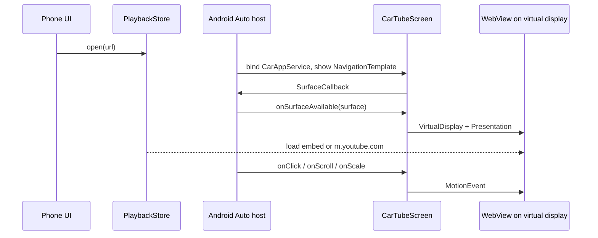

# Architecture

CarTube shows a YouTube page on the Android Auto head unit. The phone is only the remote: it accepts a URL or a search, and the car screen is the player. The app is sideloaded. It is not a Play Store navigation app, and it does not guide a route.

Playback is for a parked car or a passenger. The phone UI, the car toast, and the README all say not to watch or operate it while driving.

## Why this shape

Android Auto does not let an ordinary activity draw pixels on the head unit. Projected apps go through the Car App Library (`androidx.car.app:app:1.7.0`). Most templates are fixed lists and messages. The templates that expose a `Surface` are the map templates, and `NavigationTemplate` is the one that has been stable since early hosts.

Google's own [Draw maps](https://developer.android.com/training/cars/apps/library/draw-maps) sample is the path this app follows:

1. Declare a `CarAppService` with category `androidx.car.app.category.NAVIGATION`.
2. Return a `NavigationTemplate`.
3. Register a `SurfaceCallback` on `AppManager`.
4. When `onSurfaceAvailable` provides a `Surface`, create a `VirtualDisplay` whose output is that surface.
5. Show a `Presentation` on the virtual display. The presentation's content is a `WebView`.

The older Desktop Head Unit SDK (`com.google.android.apps.auto.sdk`) is not used. Current Android Auto hosts do not run it.

`MapWithContentTemplate` also has a surface, but it needs Car API 7 and spends part of the screen on a list. `NavigationTemplate` needs only the surface plus small action strips, and tap handling (`SurfaceCallback.onClick`) has existed since Car API 5. The manifest sets `androidx.car.app.minCarApiLevel` to 5. A Xiaomi 14 Ultra in 2026 runs a much newer Android Auto host than that.

Media browse templates are the wrong tool. They expose play/pause rows, not a video surface.

## What is declared, and what is deliberately not started

`AndroidManifest.xml` requests `androidx.car.app.NAVIGATION_TEMPLATES` and `androidx.car.app.ACCESS_SURFACE`, and `res/xml/automotive_app_desc.xml` says the app uses the template host. Those declarations are what let a host hand the app a surface. They are not what puts a GitHub build on the Android Auto 17 launcher. That is the next section.

`NavigationManager.navigationStarted()` is never called. That call tells the car a route is active. It can take the navigation slot and push the surface toward the instrument cluster. CarTube is not a navigator, so it only occupies the main template surface while the user has the app open. There is no trip, no guidance, and no cluster content.

`HostValidator.ALLOW_ALL_HOSTS_VALIDATOR` is intentional. A Play app would pin the Android Auto host signature. This build is sideloaded and also has to accept the Desktop Head Unit. Unknown sources is already an explicit switch in Android Auto's developer settings. The service is documented as exported because the projection host has to bind it.

## Why a sideloaded build shows up on Android Auto 17

Android Auto 17.x hides a sideloaded app in the navigation / template category even with the developer switch Unknown sources turned on. Google's [testing note](https://developer.android.com/training/cars/testing) says that switch covers media, messaging notifications, and parked apps, and does not cover apps built with the Car App Library. A car log captured for [Vela](https://github.com/PimpinPumpkin/Vela/issues/179) shows the same gate: on connect, gearhead asks Play who owns the package, gets an empty owner, and logs `CAR.VALIDATOR: Package DENIED`.

`androidx.car.app:app:1.7.0` has no `androidx.car.app.category.GAME`. The service categories are `NAVIGATION`, `POI`, `IOT` (Car API 6), `WEATHER` (Car API 7), plus `MEDIA`, `MESSAGING`, `CALLING`, and `SETTINGS`. `PARKING` and `CHARGING` are deprecated aliases of `POI`.

`ACCESS_SURFACE` is a manifest permission. `AppManager.setSurfaceCallback` checks that the permission was requested. The library does not also check the service category. The host only attaches a `Surface` for a map template:

| Service category | Surface | Template | Extra permission |
| --- | --- | --- | --- |
| `NAVIGATION` | Full canvas, taps since Car API 5 | `NavigationTemplate` | `NAVIGATION_TEMPLATES` |
| `POI`, `WEATHER` | Canvas beside a list, Car API 7 | `MapWithContentTemplate` | `MAP_TEMPLATES` |
| `IOT`, `MEDIA`, `MESSAGING`, `CALLING`, `SETTINGS` | None | Lists, panes, messages | — |

`PlaceListMapTemplate` draws a map for a POI app by itself, so the app never receives the surface. Moving CarTube to POI or weather would keep a list on the video. Moving it to IOT or media would remove the canvas. Those categories are still Car App Library apps, so Unknown sources would still hide a sideloaded build.

[AABrowser](https://github.com/kododake/AABrowser) is the sideload that does show up with Unknown sources. Its `<application>` sets `android:appCategory="game"`, and the activity intent filter includes `android.intent.category.CAR_LAUNCHER`. `automotive_app_desc.xml` says `media`. There is no `CarAppService`. The head unit projects that activity, and only while the car is parked. The manifest also requests `ACCESS_SURFACE` and `MAP_TEMPLATES`, but no class registers a `SurfaceCallback`. `minCarApiLevel` is 7, and `distractionOptimized` is set on the activity. Official game guidance says to leave that flag off. AABrowser is still blanked while the car moves.

[Fermata](https://github.com/AndreyPavlenko/Fermata) stays up while driving because the auto flavor bundles Google's unreleased projection library (`fermata/lib/auto/aauto.aar`) and registers `com.google.android.gms.car.category.CATEGORY_PROJECTION`. Its template `<uses>` is commented out. That binary is not something this project can ship.

On a real Android Auto 17.4 install, changing only `android:appCategory` from `maps` to `game` flipped the rejection, and the existing surface still drew (same Vela thread). The picture then greys out when the car moves. That matches this app: playback is for a parked car or a passenger.

CarTube therefore sets `android:appCategory="game"` and adds `CarPlayerActivity` with `CAR_LAUNCHER`. The `CarAppService` stays `androidx.car.app.category.NAVIGATION`, with `NavigationTemplate` and the virtual-display WebView, so a host that binds the service still gets a full-canvas surface. `distractionOptimized` is unset, and the manifest does not use `android.intent.category.APP_MAPS`. The service category is what the host needs for the surface. The application category is what Android Auto 17 reads when it decides whether a sideloaded package may draw.

Two entries can appear:

- The parked activity, on phones running Android 15 or newer. Android Auto launches it on the head unit. The WebView is the activity content, with the same user agent, Referer, and navigation policy as the surface player. Touches hit the WebView directly.
- The template, on the Desktop Head Unit and on a car that accepts the service. `CarSurfaceRenderer` is unchanged: `SurfaceCallback`, a private virtual display, a `Presentation`, and the WebView.

The foreground playback service is reference-counted across those two hosts so one of them finishing does not drop the wake lock while the other is still showing the page.

Some head units still deny the template package when Play has no install owner. The fallback is to install the GitHub APK with [KingInstaller](https://github.com/fcaronte/KingInstaller) so the recorded installer is the Play Store, then leave Unknown sources on. KingInstaller's Shizuku method is the one that does not need the Google installer session. On current Xiaomi / HyperOS builds that method often fails, and KingInstaller documents its root method as the one that works there. An update installed over the top clears the Play install record, so the same route has to be used again.

## Car surface

`CarTubeScreen` installs the surface callback before the first template is returned. The template has:

- An action strip with Home and Reload (both have an icon and a short title, which `ACTIONS_CONSTRAINTS_NAVIGATION` allows).
- A map action strip containing `Action.PAN` plus zoom in and zoom out. The host only forwards `SurfaceCallback` gestures when the PAN action is present. Zoom buttons cover head units that never emit pinch events. Map actions are icon-only.
- A pan-mode listener, so the host can enter the mode that turns a rotary or touchpad into scroll and scale.

`CarSurfaceRenderer.onSurfaceAvailable` reads width, height, and dpi from the `SurfaceContainer`. It creates the virtual display with flags `0`, the same value as the platform sample. The display is private to this process. The renderer skips the work when the same surface and size are delivered twice, and it drops the presentation before releasing the display so the WebView is not left attached to a dead window.

The `Presentation` uses the application context and a black fullscreen theme. Its content is a `FrameLayout` with one `WebView`, created from the presentation context so the view is display-aware. `onSurfaceDestroyed` dismisses the presentation, destroys the WebView, then releases the virtual display. That release is what returns the host surface.

## YouTube in the WebView

A video id (watch, youtu.be, Shorts, live, music.youtube.com, or a bare 11-character id) becomes:

`https://www.youtube.com/embed/<id>?autoplay=1&playsinline=1&...`

The load sends `Referer: https://www.youtube.com/`. Without that header, the embed endpoint often returns player error 153. The WebView user agent is the system one with `; wv` and `Version/4.0` removed, because YouTube treats those tokens as an embedded WebView and refuses the player. The Chrome version from the device is kept.

Other YouTube URLs (a channel, a playlist, the home page) are loaded as themselves, upgraded to https. A phrase that is not a URL becomes `https://m.youtube.com/results?search_query=...`, which is a touch-oriented page. `m.youtube.com/` is the idle page.

`shouldOverrideUrlLoading` allows main-frame navigations only to YouTube hosts and `https://accounts.google.com` (sign-in). `javascript:`, `intent:`, and other sites are dropped. Video bytes from `googlevideo.com` are subresource requests, not navigations, so they are not blocked here.

WebView settings that matter for playback:

- JavaScript and DOM storage on
- Third-party cookies on (the embed player needs them)
- `mediaPlaybackRequiresUserGesture = false` so autoplay can start
- File and content URL access off
- JS dialogs cancelled, because a `Presentation` has no activity window to host them
- HTML5 fullscreen is reparented into the same frame instead of asking an activity for a new window

If the renderer process dies, the callback returns true (so the app is not killed) and tries to rebuild the page twice. After that it asks the user to reopen the app.

## Touch

The host does not deliver a `MotionEvent` stream. `SurfaceCallback` reports:

| Callback | Car API | What CarTube does |
| --- | --- | --- |
| `onClick(x, y)` | 5 | Down and up at that point |
| `onScroll(dx, dy)` | 2 | A drag. Positive X is to the right, positive Y is down |
| `onFling` | 2 | Lifts the drag if one is active, otherwise `WebView.flingScroll` |
| `onScale` | 2 | `WebView.zoomBy` |

Coordinates are surface pixels. `SurfacePoints` scales them when the WebView's measured size differs from the surface, and clamps them inside the view. Events are built with `TOOL_TYPE_FINGER` and `SOURCE_TOUCHSCREEN`; a bare `MotionEvent` is often ignored by WebView.

On some head units, scroll and scale arrive only after the driver presses PAN. Taps via `onClick` are separate, and the platform notes that some cars never call `onClick`. The zoom buttons exist for that case. The car back button walks WebView history before it leaves the app.

## Phone UI and process lifetime

`MainActivity` is the phone remote. It edits the URL, shows whether `CarConnection` reports a projection, and warns on first launch. `PlaybackStore` is a `StateFlow` plus `SharedPreferences`. The template session and `CarPlayerActivity` both collect it and call `WebView.loadUrl`. The same URL can be sent again because each open bumps a generation counter.

Android Auto binds `CarTubeService` in the app process (no `android:process`). The phone activity and the car session therefore share the store. A foreground service of type `mediaPlayback` is started when the car session starts or when the user sends a URL. It holds a partial wake lock (capped at four hours), requests media audio focus, and publishes a `MediaSession` in the playing state. targetSdk is 35, and a media playback foreground service on that target is expected to have a real session. The service is stopped when the car session is destroyed. Swiping the phone task away does not remove the car surface by itself; HyperOS battery limits still can, which is why the README and the phone screen point at autostart and unrestricted battery.

Starting a foreground service from the car session can throw `ForegroundServiceStartNotAllowedException` if the phone process is considered background. That failure is logged and swallowed. The host's binding still keeps the process while the template is visible. The phone button is the reliable place to start the service, because the activity is in the foreground. `CarPlayerActivity` is itself in the foreground when the head unit launches it, so the hold it takes is allowed on that path.

## Signing and CI

No keystore is in the tree. `.gitignore` rejects `*.p12`, `*.jks`, and `*.keystore`.

`.github/workflows/android.yml`:

- On pull requests: JDK 17, Android SDK platform 35 and build-tools 35.0.0, `testDebugUnitTest assembleDebug`.
- On tags `v*`: the same test task, then `assembleRelease` with `REQUIRE_SIGNING=true`. `KEYSTORE_BASE64` is decoded to a temporary PKCS12 file. `KEYSTORE_PASSWORD`, `KEY_ALIAS`, and `KEY_PASSWORD` come from repository secrets. The APK is uploaded to GitHub Releases as `car-tube-<version>.apk`, where `<version>` is the tag without the leading `v`.

Debug builds are signed with the automatic debug key. A local `assembleRelease` without the environment variables produces an unsigned APK and does not fail the signing check.

## Trying it on the Desktop Head Unit

1. Install the debug APK and the Android Auto app.
2. Enable Android Auto developer mode (tap the version ten times) and unknown sources.
3. Start the Desktop Head Unit (`desktop-head-unit` from the SDK extras, or Android Studio's DHU) and connect the phone. The DHU skips the Play-owner check, so the template entry is the one to open there. A phone on Android 15 or newer can also show the parked `CAR_LAUNCHER` activity.
4. Open CarTube on the head unit, then send a URL from the phone.

CI does not boot an emulator or a head unit. It compiles, runs the JVM tests (URL policy, touch mapping, user-agent cleanup), and builds the APK.

## Limits

- Widevine video that requires a secure decoder is black on a normal virtual display. Standard YouTube embeds often still play; some titles will be audio-only or black. The app does not extract stream URLs or bypass that.
- The host draws its own action strips over the edges of the surface. That chrome is not part of the WebView.
- Gesture coverage depends on the head unit. PAN is required for drags on many systems.
- YouTube can change the embed page and break WebView playback without an app update.
- The service category stays `NAVIGATION` so the host can hand over a surface. The application category is `game`, so Android Auto 17 can list a sideloaded build, and it can blank that entry while the car is moving. Do not use it while driving.
